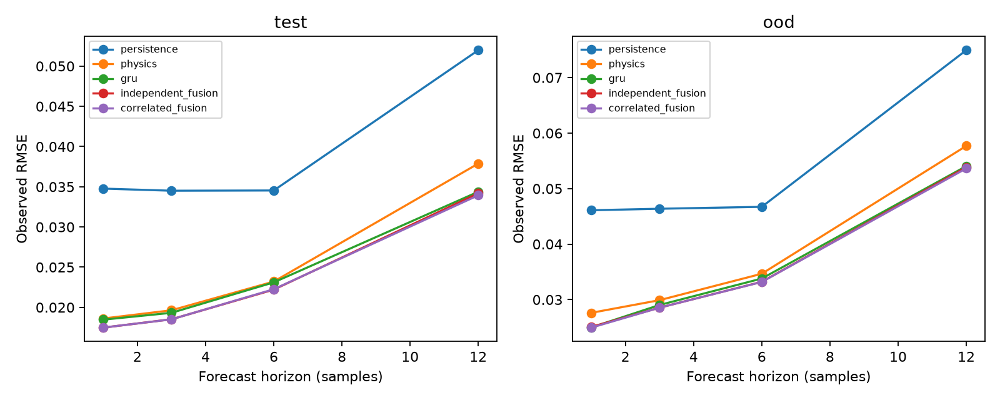

# Causal soft-sensor benchmark

[](https://github.com/Mioulin/causal-soft-sensor-benchmark/actions/workflows/tests.yml)

A reproducible numerical study of online state prediction in a six-stage process with rotating observations, mechanistic mismatch and distribution shift. All data are generated by an original simulator. No industrial data or employer code are redistributed.

**COMPLETED:** three CPU GRU training runs, checkpoint reload, independent test and kinetic-shift evaluation; persistence, physics and two fusion controls. Results are measured, not illustrative. Public repository: [causal-soft-sensor-benchmark](https://github.com/Mioulin/causal-soft-sensor-benchmark).

## Reproduce

Python 3.12, CPU; the measured environment used PyTorch 2.15.0 and NumPy 2.5.4. Dependencies are pinned in `uv.lock`.

```bash
uv sync --python 3.12 --frozen
uv run pytest -q
uv run ruff check .
uv run python benchmark.py --output results --epochs 18
```

The executed run used the identical versions from the companion post-training lab environment. Seed-specific training time is in `results/training_*.json`. Training uses two CPU threads and does not require CUDA, MPS or paid infrastructure. Change `--output` to preserve existing artefacts.

## Scientific design

24 complete training runs, 8 validation, 8 test and 8 out-of-distribution runs; 240 samples per run, 18-sample windows, horizons 1/3/6/12. A 32-unit GRU predicts six stage values per horizon using masked MSE on observable targets. Normalisation and validation-only checkpoint selection are explicit. Independent and correlated-error fusion weights are estimated exclusively on validation errors. Future controls are frozen at the current value during forecasting.

The current observation at forecast time is available by design. Tests prove prefix invariance under altered future observations/control, correct target indexing and run isolation, masked grading and fusion algebra. Neither a measurement at t+h nor a future-interpolated target enters the model inputs. Mechanistic equations intentionally resemble, but differ from, the simulator, so mechanistic advantage is conditional on that assumed world.

## Measured results

At horizon 12, mean test RMSE over three training seeds: persistence 0.0520; physics 0.0379; GRU 0.0344; independent fusion 0.0342; correlated fusion 0.0339. Correlated fusion OOD RMSE is 0.0536. These are dimensionless simulated errors, not plant performance.

See [full report](results/report.md), [metrics](results/metrics.json), [cluster intervals](results/paired.json) and [Russian guide](docs/learning_guide_ru.md).



Intervals resample only eight complete test runs. Three training seeds do not create more independent test data. Empirical residual intervals have no distribution-free guarantee under autocorrelation or drift. Some methods/horizons worsen; all results are retained. Real-plant validation, transformer comparisons and future-control oracle are NOT RUN.

`benchmark.py` contains simulation, causal replay, training, fusion, evaluation and report generation. `test_benchmark.py` exercises the key validity properties. GRU uses the maintained [PyTorch implementation](https://docs.pytorch.org/docs/main/generated/torch.nn.GRU.html). Original code is MIT; synthetic data are CC0-1.0. Large checkpoints are excluded from Git but locally available and reproducible.

To independently reload all three checkpoints and recompute all 120 metric rows from stored predictions:

```bash
uv run python verify_results.py
```

`results/verification.json` records this check and SHA-256 hashes. The coverage and validation-loss figure is `results/diagnostics.png`; OOD coverage can fall substantially below nominal 95%.
